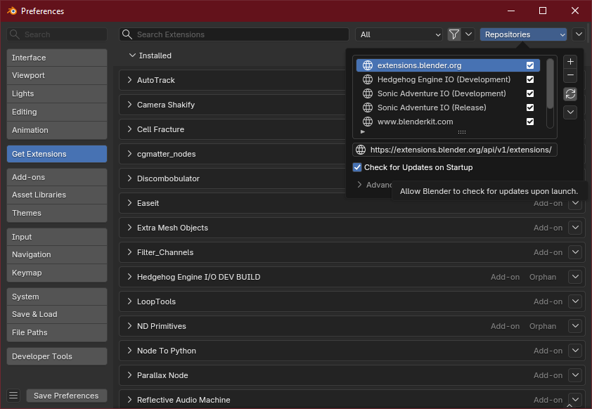
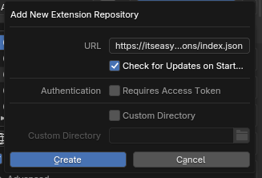
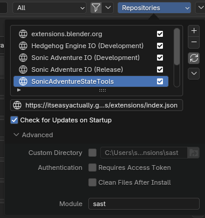
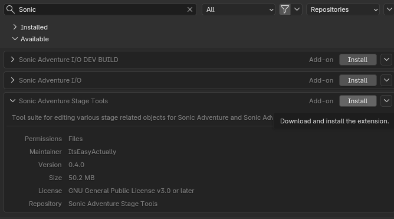

---
hide:
    - navigation
    - toc
    - footer
---

# Extension Installation
!!! note Blender Extensions
    The Extensions platform in Blender allows for addons to be automatically updated through Blender itself. Please head over to the [Blender Extensions about](https://extensions.blender.org/about/) page to read more on enabling Extensions in Blender before continuing.

The SAST Addon hosts its own Extension repository through this website. The instructions below are how you add the Extension Repository to Blender. 

First, please copy the below url to the `index.json`.

```
https://itseasyactually.github.io/SonicAdventureStageTools/extensions/index.json
```

Once copied, in Blender, click on Edit and select Preferences. In the Preferences window, click on the Get Extensions side button, and click on the Repositories drop down.


Press the `+` icon and select `Add Remote Repository` and paste the link into the URL box. Be sure to check the `Check for Updates on Startup` to ensure updates are checked for on startup.


Once filled out, you can click the Create button to add the repository to the list. It will appear as `itseasyactually.github.io` in the list. You can double click on it to rename to whatever you like, but I recommend naming it `Sonic Adventure Stage Tools`. With it selected, make sure to click on the Advanced panel and set the module name to `sast`.


!!! note
    If you receive an error once renaming for a sync issue, simply click the sync button on the repository settings. It's the icon with the arrows in a circle.

Once the repository is sync'd and you don't see any errors, you can run a search for "Sonic" which should return the Sonic Adventure Stage Tools as a result in the Available list. You can click install and the addon will be installed.


Once the addon has downloaded, you're all set!

# Manual Installation
If you don't want to enable Online capabilities within Blender for Extensions, official releases for the addon continue to be published to the releases page.

[Follow this link](https://github.com/ItsEasyActually/SonicAdventureStageTools/releases) to get to the latest releases file for the addon.

From there, find the latest release and get the `SonicAdventureStageTools.zip` file.

Once downloaded, you can install it manually as a Legacy addon for Blender. You can follow [this](https://docs.blender.org/manual/en/latest/editors/preferences/addons.html) on how to install Legacy addons for Blender if you are unfamiliar.

Please note that this will not auto update and any updates will have to be manually downloaded.